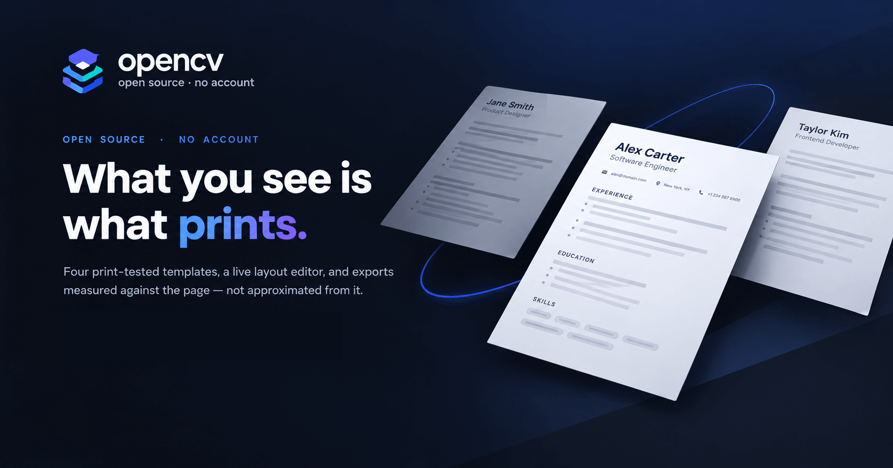
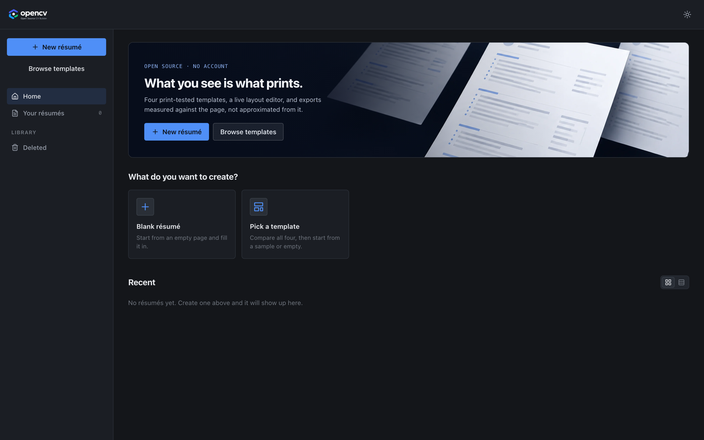
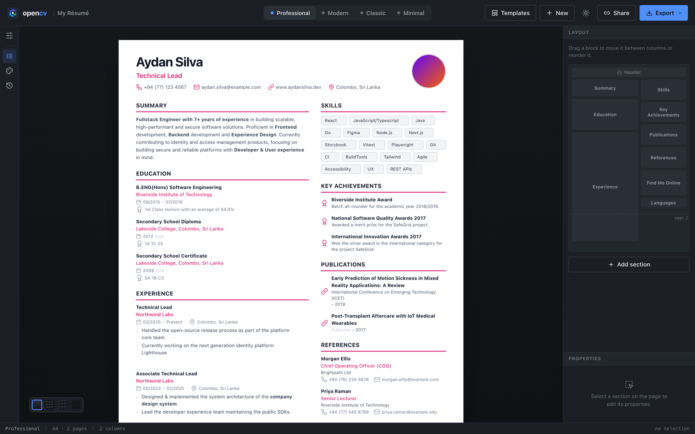
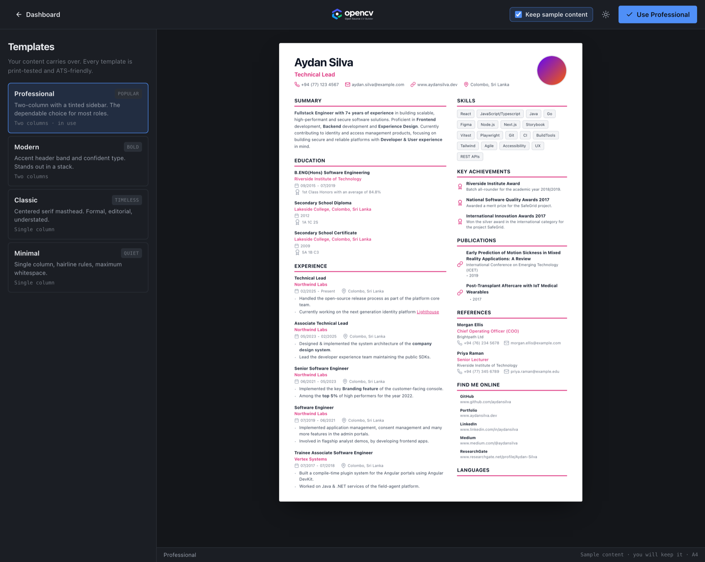
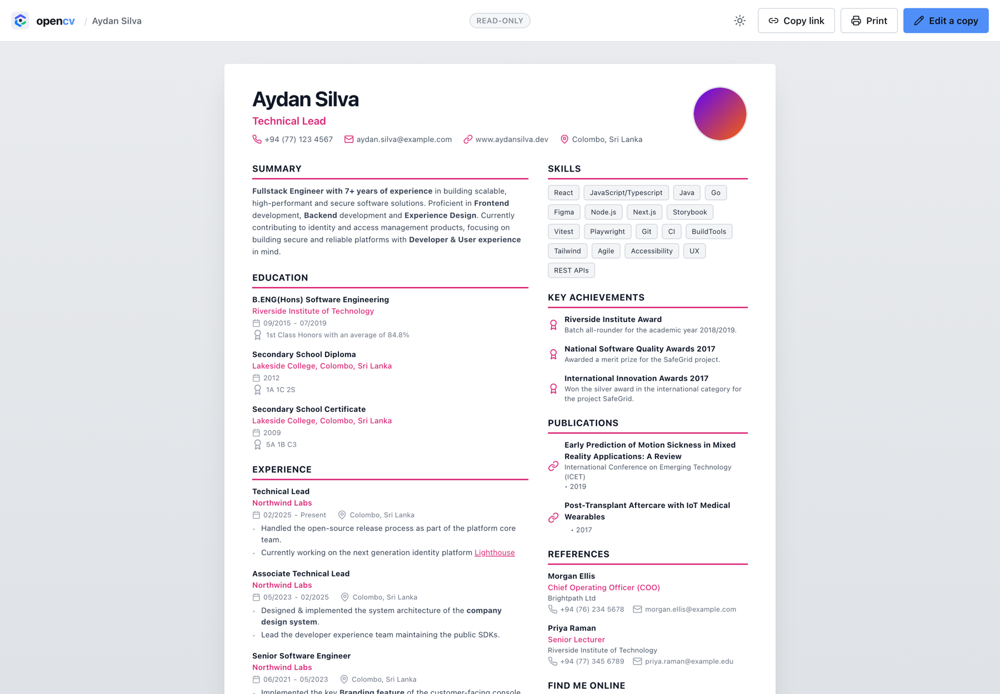

[](https://brionmario.github.io/opencv)

# OpenCV

**The resume builder that stores nothing.** Four print-tested templates, a live
editor that renders A4 at true scale, and exports measured against the page
rather than approximated from it. No account, no database, no upload.

### [Open the app →](https://brionmario.github.io/opencv)



## What it does

- **Writes to the page, not to a preview.** The canvas is A4 at true scale, and
  the PDF export measures against the same geometry, so page breaks land where
  you saw them.
- **Four templates, one document.** Professional, Modern, Classic and Minimal.
  Your content carries over when you switch; you are picking a layout, not
  starting again.
- **Exports in five formats.** PDF, a self-contained HTML page, Markdown,
  [JSON Resume](https://jsonresume.org/schema) and a full opencv document for
  backup.
- **Keeps a history.** Auto-saved versions you can label, compare and restore.
- **Stores nothing anywhere else.** Your résumés live in your own browser.
  There is no account to create and no server holding a copy.

## Getting started

1. Open [the app](https://brionmario.github.io/opencv).
2. Choose **New résumé** for an empty page, or **Browse templates** to start
   from a sample you can edit over.
3. Click anything on the page to edit it in place. The left rail switches
   between layout, sections, theme and version history; the right panel holds
   the properties of whatever you have selected.
4. **Export** when you are done.

Everything is saved as you type. Closing the tab is safe; coming back to the
same browser brings your documents with you.



### Picking a template

| Template | Columns | Suits |
| --- | --- | --- |
| **Professional** | Two | Two-column with a tinted sidebar. The dependable choice for most roles. |
| **Modern** | Two | Accent header band and confident type. Stands out in a stack. |
| **Classic** | One | Centered serif masthead. Formal, editorial, understated. |
| **Minimal** | One | Single column, hairline rules, maximum whitespace. |

Every one of them is print-tested and ATS-friendly. Switching is a single
click, and your content comes with you.



## Sharing your CV

Press **Share** in the editor and OpenCV copies a link to your clipboard. Send
it to anyone: it opens a read-only view of your résumé with **Copy link**,
**Print** and **Edit a copy** on it.



The link **is** the document. Nothing is stored on a server, so the whole
résumé travels inside the URL. That has consequences worth knowing:

- It works for anyone, with no account, for as long as the site is up.
- **It cannot be revoked.** Sharing a link is giving out the résumé itself.
  Treat it like emailing the PDF.
- Editing your résumé does not change a link you already sent. The old link
  keeps resolving to the version it carries. Share a fresh one to share
  changes.
- It is long, a few KB, and it breaks if something truncates it. A link with an
  embedded photo is much longer; the app warns you when it crosses the length
  some apps start shortening at.
- The document rides in the URL's fragment, which browsers never send to a
  server. It stays out of access logs and out of `Referer` headers.

If you would rather hand over a file, **Export** gives you a PDF, a
self-contained HTML page, Markdown or JSON Resume.

## Connecting an AI agent (MCP)

OpenCV ships an [MCP](https://modelcontextprotocol.io) server, so an agent such
as Claude can draft, read and revise a résumé and hand you back a share link.

It is not published to a registry yet, so build it from a clone:

```bash
git clone https://github.com/brionmario/opencv.git && cd opencv && pnpm install
```

```bash
npx nx run @brionmario/opencv-mcp:build
```

Register it with Claude Code:

```bash
claude mcp add opencv -- node /absolute/path/to/opencv/packages/mcp/dist/index.js
```

Or, for any other MCP client, add it to that client's config:

```json
{
  "mcpServers": {
    "opencv": {
      "type": "stdio",
      "command": "node",
      "args": ["/absolute/path/to/opencv/packages/mcp/dist/index.js"]
    }
  }
}
```

The agent then has five tools: `list_templates`, `get_sample_resume`,
`create_resume`, `read_resume` and `update_resume`. It speaks JSON Resume, and
every link it produces opens in the same app you use. Full details, including
how to point it at a different deployment, are in
[`packages/mcp/README.md`](packages/mcp/README.md).

## Privacy

There is no account, no database and no résumé upload. Documents are held in
your browser's local storage, and a shared document is carried inside its own
link rather than stored anywhere. Clearing your browser data deletes your
résumés, so export a copy of anything you want to keep.

The one exception is the optional AI suggestion feature, which sends the text
you ask it about to a model provider. It is off unless you use it.

## Contributing

Bug reports, features and pull requests are all welcome. The development setup,
the workspace layout and the conventions are in
[CONTRIBUTING.md](CONTRIBUTING.md).

## License

[MIT](LICENSE).

---

Made with ❤️ by [@brionmario](https://github.com/brionmario) and contributors.
